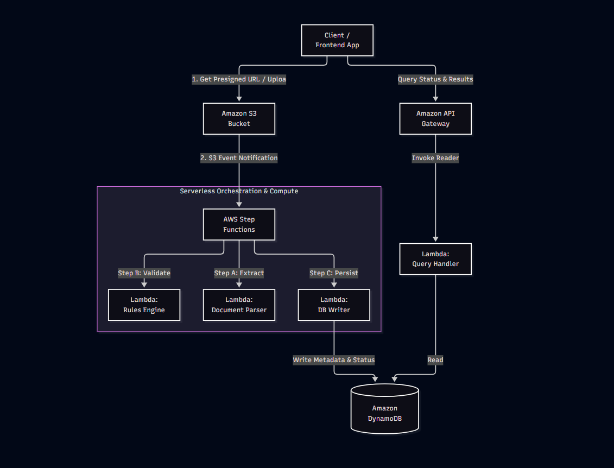

# AuditFlow - Serverless Document Auditing Backend

AuditFlow is an automated, serverless document auditing and compliance verification platform designed to ingest, parse, and validate legal and corporate documents at scale using AWS serverless infrastructure.

## 📐 Architecture Diagram



## 🚀 Core Architecture & Workflow

The system is built entirely on asynchronous, event-driven serverless components to ensure high scalability and zero idle server costs:

1. **Document Ingestion & Storage:** 
   * The client application requests a presecured upload URL from **Amazon API Gateway**.
   * The file is uploaded directly to an **Amazon S3 Bucket**.
2. **Event-Driven Orchestration:**
   * S3 triggers an event notification upon successful upload, which initiates an **AWS Step Functions** state machine.
3. **Parallel Processing & Validation:**
   * **Step Functions** orchestrates three parallel serverless **AWS Lambda** workers:
     * **Step A (Extract):** Document Parser Lambda extracts raw text and structural data.
     * **Step B (Validate):** Rules Engine Lambda runs compliance and validation checks against predefined policies.
     * **Step C (Persist):** DB Writer Lambda writes processing logs and metadata.
4. **Data Persistence & Retrieval:**
   * All execution metadata, parsing statuses, and validation results are durably stored in **Amazon DynamoDB**.
   * Clients query audit statuses and results through **Amazon API Gateway** backed by a Query Handler Lambda.

## 🛠️ Tech Stack & Services
* **Compute & Orchestration:** AWS Lambda, AWS Step Functions
* **Storage & Database:** Amazon S3, Amazon DynamoDB
* **API & Networking:** Amazon API Gateway
* **Infrastructure as Code:** AWS SAM (Serverless Application Model) / CloudFormation

## 📂 Project Structure
```
auditflow-serverless/
│
├── template.yaml         # AWS SAM infrastructure template (API Gateway, S3, Step Functions, Lambdas, DynamoDB)
├── src/                  # Lambda function source code handlers
│   ├── parser/           # Document extraction logic (Lambda)
│   ├── validator/        # Rules engine evaluation logic (Lambda)
│   └── handler/          # API query and persistence handlers (Lambda)
│
├── statemachine/         # Step Functions ASL (Amazon States Language) definition
├── tests/                # Unit and integration test suites
└── README.md             # Project documentation & architecture
```
Deployment (AWS SAM)
To deploy this serverless architecture to AWS:

1.Ensure AWS CLI and AWS SAM CLI are installed and configured.

2.Build the serverless application:
```
sam build
```
3.Deploy to your AWS account:
```
sam deploy --guided
```
Local Testing & Verification
Since this project is architected around serverless AWS services, local testing focuses on validating individual handlers and state transitions:
1. **Unit Testing:** Run test suites via Pytest to validate parsing and validation logic independently:
   ```
   pytest tests/
   ```
2.Mock Event Testing: Use local event payloads to invoke Lambda function handlers directly prior to deployment.

## 🧪 Local Testing & Verification

Since this project is architected around serverless AWS services, local testing focuses on validating individual handlers and state transitions:

1. **Unit Testing:** Run test suites via Pytest to validate parsing and validation logic independently:
   ```
   pytest tests/
   ```
2.Mock Event Testing: Use local event payloads to invoke Lambda function handlers directly prior to deployment.

   ## 🔒 Security & Compliance Features

* **Presigned URLs:** Client uploads bypass the backend server entirely, utilizing time-limited secure S3 presigned URLs to prevent unauthorized storage access.
* **Stateless Processing:** Step Functions orchestrate tasks securely with scoped IAM roles adhering to the principle of least privilege.
* **Audit Trail:** Every validation step and status change is immutably recorded in DynamoDB for traceability.

## 🏁 Conclusion

AuditFlow provides a robust, resilient, and fully event-driven architecture for automated document compliance—eliminating manual overhead and ensuring predictable scaling for corporate auditing workflows.
